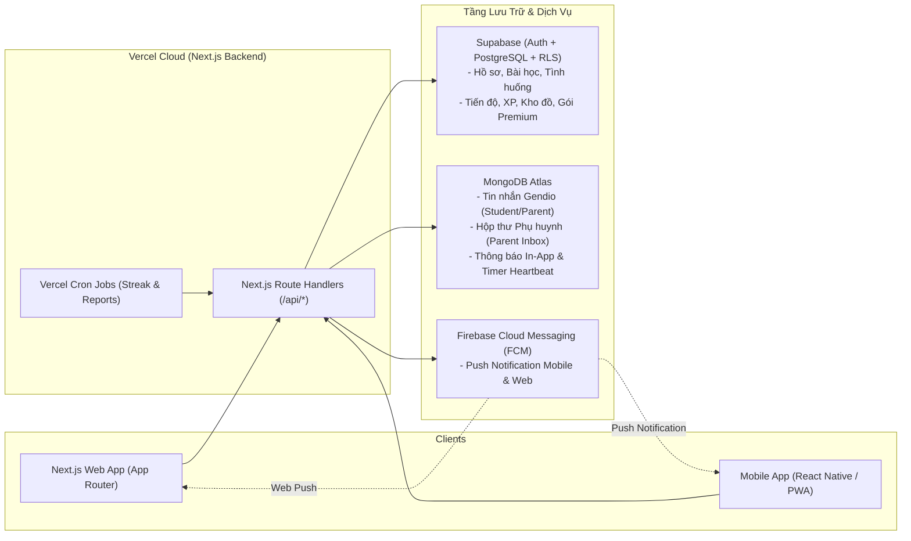
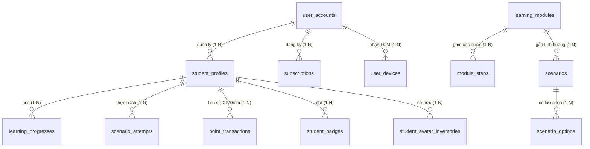

# Phân Tích SRS & Thiết Kế Kiến Trúc Hệ Thống GenUp (Web & Mobile)

> **Tài liệu gốc:** `IB1912_GROUP3_SRS.pdf` (87 trang)  
> **Tên dự án:** **GenUp** – Ứng dụng giáo dục giới tính, cảm xúc và kỹ năng tự bảo vệ dành cho học sinh THCS (11–15 tuổi)  
> **Thông điệp sản phẩm:** *"Lớn lên tự tin, an toàn mỗi ngày."*  
> **Kiến trúc triển khai chốt:** **Next.js Full-stack (Frontend + Backend Route Handlers) trên Vercel** + **Supabase (Auth & PostgreSQL)** + **MongoDB (Tin nhắn Gendio, Hộp thư, Thông báo & Heartbeat)** + **Firebase Cloud Messaging (Push Notification Mobile & Web)**.

---

## 1. Tổng Quan Dự Án & Quy Tắc Nghiệp Vụ Cốt Lõi

* **Lĩnh vực:** EdTech (Giáo dục giới tính, tuổi dậy thì, trí tuệ cảm xúc EQ, ranh giới cá nhân và an toàn trên không gian mạng).
* **Mô hình người dùng kép (Dual-User Model) & Chế độ Demo thống nhất (Mục 4.1–4.4 SRS):**
  * **Học sinh THCS (11–15 tuổi, Lớp 6–9):** Người trực tiếp học tập, tương tác tình huống, nhận thưởng Gamification, cá nhân hóa nhân vật 2D Avatar.
  * **Phụ huynh / Người giám hộ (30–45 tuổi):** Người đồng hành, theo dõi tiến độ tổng quan, nhận báo cáo định kỳ và chi trả gói Premium.
  * **Hỗ trợ song song 2 chế độ vận hành:**
    1. **Chế độ Demo / Đánh giá nhanh (Unified Profile Flow - Mục 4.2 SRS):** Cho phép chuyển nhanh giữa khu vực Học sinh và Góc Phụ huynh trên cùng một hồ sơ với dữ liệu đồng bộ `LocalStorage` + Cloud fallback.
    2. **Chế độ Tài khoản thật (Production Auth - `US-45`, `US-46`):** Xác thực qua **Supabase Auth**, bảo vệ Góc Phụ Huynh bằng mã PIN 4–6 số và phân quyền Row-Level Security (RLS).
* **Mô hình kinh doanh (Freemium):**
  * **Gói Free:** Giới hạn **15 phút (900 giây) học chủ động/ngày** (`US-30`). Bộ đếm thông minh (*Smart Timer* - `US-31`) tự động tạm dừng khi ẩn tab/ứng dụng hoặc không tương tác quá **60 giây**. Khi hết giờ, khóa học thêm bài mới trong ngày nhưng bảo toàn toàn bộ tiến độ.
  * **Gói Premium (~500.000 VNĐ/năm hoặc theo tháng):** Mở khóa không giới hạn thời gian học, toàn bộ chủ đề nâng cao và báo cáo phân tích chi tiết cho phụ huynh (`US-32`, `US-49`).
* **Nguyên tắc Bảo vệ Quyền riêng tư (`NFR-S06`, `US-35`, `US-36`):**
  * Phụ huynh được xem **dữ liệu tổng hợp** (số bài hoàn thành, chuỗi ngày học Streak, tiến độ theo chủ đề, thời lượng học).
  * Phụ huynh **tuyệt đối không được xem** đáp án tình huống cụ thể học sinh đã chọn (`SelectedOptionId`) hoặc nội dung cuộc trò chuyện riêng tư của học sinh với trợ lý Gendio trong MongoDB.

---

## 2. Danh Sách 6 Actors (Tác Nhân Hệ Thống)

| STT | Actor | Phân loại | Vai trò & Trách nhiệm trong hệ thống |
| :-: | :--- | :--- | :--- |
| **1** | **Học sinh THCS (Student)** | Primary User | Tạo hồ sơ học tập, chọn & tùy chỉnh 2D Avatar, học bài theo từng bước, xử lý tình huống tương tác, tích lũy XP/Reward Points/Streak/Badges, mua vật phẩm Avatar và hỏi trợ lý Gendio. |
| **2** | **Phụ huynh / Giám hộ (Parent)** | Secondary User | Đăng ký tài khoản gia đình, liên kết hồ sơ con, xem Parent Dashboard tổng hợp, xem/nhận báo cáo chu kỳ 7/14/30 ngày qua Hộp thư & Email, cấu hình thông báo, nâng cấp gói Premium và dùng Gendio Phụ huynh. |
| **3** | **Quản trị viên (System Admin)** | Internal Actor | Quản lý tài khoản người dùng, phân quyền RBAC, quản lý danh mục vật phẩm/huy hiệu, xuất bản bài học trên CMS và giám sát vận hành hệ thống. |
| **4** | **Chuyên gia nội dung (Content Expert)** | Internal Actor | Chuyên gia tâm lý / giáo dục: biên soạn, rà soát và phê duyệt nội dung bài học, tình huống và câu trả lời mẫu của Gendio trước khi xuất bản (`Draft` → `Approved`). |
| **5** | **Dịch vụ Thanh toán (Payment Service)** | External System | Cổng thanh toán (PayOS VietQR / VNPAY) xử lý giao dịch mua gói Premium và gửi Webhook xác nhận trạng thái thuê bao. |
| **6** | **Dịch vụ Thông báo & Email (Firebase FCM & Resend)** | External System | **Firebase Cloud Messaging (FCM)** đẩy Push Notification về điện thoại nhắc Streak/nhiệm vụ; **Resend/SMTP** gửi email báo cáo tiến độ định kỳ tới phụ huynh. |

---

## 3. Danh Sách Toàn Bộ Tính Năng (28 Use Cases & 52 User Stories)

### 3.1. Phân hệ 1: Tài khoản, Onboarding & Hồ sơ Học sinh
| Mã UC | Mã US | Tên tính năng | Actor | Mô tả chi tiết & Quy tắc nghiệp vụ |
| :--- | :--- | :--- | :--- | :--- |
| **UC-24** | `US-45` | Đăng ký, Đăng nhập & Khôi phục mật khẩu | Phụ huynh / Học sinh | Xác thực bằng Supabase Auth (JWT + Cookie SSR); hỗ trợ quên mật khẩu qua Email OTP; phân tách phiên làm việc an toàn. |
| **UC-25** | `US-46` | Liên kết an toàn Phụ huynh – Học sinh | Phụ huynh | Một tài khoản Phụ huynh quản lý 1 hoặc nhiều `StudentProfile`; bảo vệ Góc Phụ Huynh bằng mã PIN hoặc tài khoản riêng; chặn truy cập chéo giữa các gia đình bằng Supabase RLS. |
| **UC-01** | `US-01`, `US-03` | Thực hiện Onboarding & Tạo hồ sơ học tập | Học sinh | Nhập biệt danh (không được để trống/toàn khoảng trắng), chọn khối lớp (Lớp 6–9), chọn các chủ đề quan tâm. Có thể chọn nhân vật hoặc dùng nhân vật mặc định. |
| **UC-02** | `US-04` | Chỉnh sửa hồ sơ học sinh | Học sinh | Cập nhật biệt danh, khối lớp, chủ đề quan tâm tại màn hình Cài đặt mà không làm mất tiến độ học. |
| **UC-03** | `US-05`, `US-06` | Chọn nhân vật & Tùy chỉnh kiểu tóc | Học sinh | Chọn nhân vật đại diện (Nam/Nữ), xem trước (preview) và lưu kiểu tóc trong **Avatar Studio**. |

### 3.2. Phân hệ 2: Bài học có cấu trúc & Tình huống tương tác (Core Learning)
| Mã UC | Mã US | Tên tính năng | Actor | Mô tả chi tiết & Quy tắc nghiệp vụ |
| :--- | :--- | :--- | :--- | :--- |
| **UC-04** | `US-07`, `US-08` | Duyệt, tìm kiếm và lọc thư viện bài học | Học sinh | Xem danh sách bài học, tìm theo từ khóa (tiêu đề, mô tả), lọc theo chủ đề, hiển thị rõ trạng thái *Chưa học / Đang học / Đã hoàn thành*. |
| **UC-05** | `US-09`, `US-10` | Học nội dung theo từng bước (Step-by-step) | Học sinh | Mỗi bài học chia thành các bước kiến thức ngắn kèm thanh tiến độ; điều hướng *Tiếp tục / Quay lại* mượt mà. |
| **UC-06** | `US-11`, `US-12` | Thực hành tình huống tương tác (Scenarios) | Học sinh | Thực hành tình huống gắn cuối bài học hoặc trong **Scenario Library** độc lập. Học sinh đọc bối cảnh và đưa ra lựa chọn xử lý. |
| **UC-07** | `US-13`, `US-14` | Nhận phản hồi & Giải thích không phán xét | Học sinh | Hiển thị ngay phản hồi tương ứng với phương án đã chọn và giải thích lý do/hệ quả. Cộng **+30 XP** lần đầu vượt qua tình huống an toàn. |
| **UC-08** | `US-15`, `US-16` | Hoàn thành và ôn tập lại bài học | Học sinh | Phải trả lời tình huống bắt buộc mới được tính hoàn thành bài. Cộng **+50 XP** ở lần hoàn thành đầu tiên; học lại để ôn tập ghi nhận nhiệm vụ review trong ngày nhưng không cộng trùng XP. |
| **UC-09** | `US-17` | Tiếp tục bài học đang dở | Học sinh | Tự động lưu bước học hiện tại (`current_step_index`) để khôi phục đúng vị trí khi mở lại ứng dụng. |
| **UC-10** | `US-18` | Nhận gợi ý bài học tiếp theo | Học sinh | Sau khi hoàn thành 1 bài, hệ thống tự động đề xuất bài học kế tiếp phù hợp chưa hoàn thành (ưu tiên bài đang học dở). |

### 3.3. Phân hệ 3: Theo dõi Tiến độ & Đồng bộ Đa thiết bị
| Mã UC | Mã US | Tên tính năng | Actor | Mô tả chi tiết & Quy tắc nghiệp vụ |
| :--- | :--- | :--- | :--- | :--- |
| **UC-11** | `US-19`, `US-20`, `US-22` | Xem Student Dashboard & Progress | Học sinh | Tổng hợp số bài đã hoàn thành, số tình huống đã giải quyết, tổng XP, chuỗi Streak hiện tại và tỷ lệ hoàn thành theo từng chủ đề. |
| **UC-26** | `US-47`, `US-52` | Đồng bộ tiến độ đa thiết bị (Web & Mobile) | Học sinh | Đồng bộ tức thì trạng thái bài học, bước đang học dở, XP, kho đồ Avatar giữa trình duyệt Web và ứng dụng Mobile Native qua Supabase + MongoDB. |

### 3.4. Phân hệ 4: Nhân vật 2D Avatar & Gamification
| Mã UC | Mã US | Tên tính năng | Actor | Mô tả chi tiết & Quy tắc nghiệp vụ |
| :--- | :--- | :--- | :--- | :--- |
| **UC-12** | `US-23`, `US-24` | Nhận XP, Điểm thưởng & Nhiệm vụ ngày | Học sinh | Tích lũy XP (+50 XP bài học, +30 XP tình huống) và Điểm thưởng (Reward Points) khi hoàn thành nhiệm vụ hàng ngày (Daily Missions). |
| **UC-13** | `US-25`, `US-26` | Duy trì Learning Streak & Thưởng cột mốc | Học sinh | Ghi nhận chuỗi ngày có hoạt động học tập hợp lệ liên tiếp; trao thưởng một lần khi đạt các mốc **3 ngày, 7 ngày, 14 ngày**. |
| **UC-14** | `US-27` | Mở khóa Huy hiệu (Badges) | Học sinh | Tự động mở khóa và lưu trữ huy hiệu khi học sinh đạt các điều kiện thành tích. |
| **UC-15** | `US-28`, `US-29` | Mua và trang bị vật phẩm Avatar | Học sinh | Dùng Reward Points mua trang phục/kiểu tóc/phụ kiện trong Shop; trừ điểm chính xác bằng Postgres Function/Transaction (chống mua trùng) và mặc lên Avatar 2D. |

### 3.5. Phân hệ 5: Freemium (Smart 15-Min Timer) & Gói Premium
| Mã UC | Mã US | Tên tính năng | Actor | Mô tả chi tiết & Quy tắc nghiệp vụ |
| :--- | :--- | :--- | :--- | :--- |
| **UC-16** | `US-30`, `US-31` | Giới hạn 15 phút học miễn phí/ngày | Học sinh | Đếm thời gian học thực tế (tối đa 900 giây/ngày cho gói Free). Tự động tạm dừng khi ẩn tab/app hoặc idle > 60 giây. Hết giờ sẽ chặn vào bài học/tình huống mới nhưng vẫn xem được hồ sơ/tiến độ. |
| **UC-17** | `US-32`, `US-49` | So sánh gói & Thanh toán nâng cấp Premium | Phụ huynh | Xem bảng quyền lợi Free vs. Premium, chọn chu kỳ gói (Tháng/Năm), kích hoạt mô phỏng (Demo) hoặc thanh toán qua cổng thanh toán. |

### 3.6. Phân hệ 6: Góc Phụ Huynh (Parent Zone), Báo cáo & Email
| Mã UC | Mã US | Tên tính năng | Actor | Mô tả chi tiết & Quy tắc nghiệp vụ |
| :--- | :--- | :--- | :--- | :--- |
| **UC-18** | `US-35` | Xem Parent Dashboard (Bảo mật riêng tư) | Phụ huynh | Xem tổng quan tiến độ học tập của con theo chủ đề, số bài đã học, Streak. **Ẩn hoàn toàn** câu trả lời tình huống cụ thể và lịch sử chat của con. |
| **UC-19** | `US-36` | Xem báo cáo học tập theo chu kỳ | Phụ huynh | Xem thống kê tổng hợp theo bộ lọc **7 ngày, 14 ngày, 30 ngày**. |
| **UC-20** | `US-37`, `US-38` | Quản lý Hộp thư Phụ huynh (Parent Inbox) | Phụ huynh | Lưu trữ trên **MongoDB**: tạo/đọc thông báo tiến độ, nhắc học, bài học mới, Premium; đánh dấu đã đọc hoặc xóa thư. |
| **UC-21** | `US-39` | Cấu hình thông báo Email | Phụ huynh | Bật/tắt từng nhóm email (Báo cáo tiến độ, Nhắc nhở học tập, Nội dung mới, Khuyến mãi Premium) và chọn tần suất nhận (7/14/30 ngày). |
| **UC-27** | `US-48` | Gửi Email báo cáo & nhắc học tự động | Dịch vụ Email / Phụ huynh | Vercel Cron Job định kỳ tổng hợp dữ liệu (tuân thủ quy tắc ẩn thông tin nhạy cảm), lưu vào MongoDB `parent_inbox_messages` và gửi email qua Resend. |

### 3.7. Phân hệ 7 & 8: Trợ lý Gendio, Thông báo & Quản trị CMS
| Mã UC | Mã US | Tên tính năng | Actor | Mô tả chi tiết & Quy tắc nghiệp vụ |
| :--- | :--- | :--- | :--- | :--- |
| **UC-22** | `US-40`, `US-50` | Hỏi đáp cùng trợ lý ảo Gendio | Học sinh / Phụ huynh | Lưu tin nhắn trong **MongoDB** (`gendio_messages`). Trợ lý Gendio riêng cho Học sinh (giải đáp kiến thức theo từ khóa/FAQ + AI có kiểm duyệt, hướng dẫn tìm người lớn tin cậy khi có dấu hiệu nguy hiểm) và Gendio cho Phụ huynh (FAQ sử dụng app, gợi ý đồng hành cùng con). |
| **UC-23** | `US-42` | Thông báo trong ứng dụng & Push Notification | Học sinh | Lưu trong **MongoDB** (`in_app_notifications`) và đẩy qua **Firebase Cloud Messaging (FCM)** về thiết bị di động; hỗ trợ đánh dấu đã đọc từng mục hoặc tất cả. |
| **UC-28** | `US-51` | Hệ thống Quản trị Nội dung (CMS) | Admin / Chuyên gia | Tạo/sửa bài học và tình huống trên Supabase theo quy trình kiểm duyệt: `Draft` → `PendingReview` → `Approved` → `Published`. |

---

## 4. Kiến Trúc Lưu Trữ Kép: Supabase (PostgreSQL) + MongoDB + Firebase FCM

Để tận dụng tối đa thế mạnh của từng công nghệ trên **Vercel Serverless**:



### 4.1. Phân định ranh giới dữ liệu (Không chồng chéo Transaction)

| Nguồn lưu trữ | Bảng / Collection | Lý do kỹ thuật |
| :--- | :--- | :--- |
| **Supabase (PostgreSQL + RLS)** | `user_accounts`, `student_profiles`, `learning_modules`, `module_steps`, `scenarios`, `scenario_options`, `learning_progresses`, `scenario_attempts`, `point_transactions`, `student_badges`, `student_avatar_inventories`, `subscriptions`, `user_devices` | Cần tính toàn vẹn quan hệ (Foreign Keys), chống cộng trùng XP (`UNIQUE`), trừ điểm mua đồ an toàn (ACID Transaction) và phân quyền dòng dữ liệu bằng **Supabase RLS**. |
| **MongoDB Atlas** | `gendio_messages`, `parent_inbox_messages`, `in_app_notifications`, `daily_usage_heartbeats` | Dữ liệu dạng chuỗi tin nhắn, hộp thư nội bộ và nhịp tim (heartbeat 15–30s/lần) có tần suất ghi (write-heavy) cao, cấu trúc payload linh hoạt và hỗ trợ **TTL Index** tự dọn log cũ. |
| **Firebase (FCM)** | `firebase-admin` Messaging + `fcm_token` trong `user_devices` | Gửi thông báo đẩy (Push Notification) xuống iOS/Android/Web khi đạt huy hiệu, nhắc học giữ Streak lúc 20:00 mỗi tối và báo cáo tuần cho phụ huynh. |

---

## 5. Thiết Kế Cơ Sở Dữ Liệu Chi Tiết

### 5.1. Lược đồ Supabase (PostgreSQL + RLS Best Practices)

Tuân thủ chuẩn bảo mật Supabase:
* Bật `ENABLE ROW LEVEL SECURITY` trên tất cả các bảng trong `public`.
* Sử dụng mệnh đề `TO authenticated` kết hợp `(select auth.uid()) = ...` (tối ưu initPlan caching của Postgres, không dùng `auth.role()` đã deprecated hay `user_metadata` không an toàn).
* Đánh Index đầy đủ cho toàn bộ khóa ngoại (`Foreign Key`).
* Tạo View `parent_child_summary_view` với `WITH (security_invoker = true)` để đảm bảo `NFR-S06` (Phụ huynh không bao giờ đọc được `selected_option_id` trong `scenario_attempts`).



### 5.2. Lược đồ Collections trên MongoDB

1. **`gendio_messages` (Tin nhắn với Trợ lý Gendio - `US-40`, `US-50`):**
   ```json
   {
     "_id": "ObjectId",
     "sessionId": "uuid",
     "actorRole": "student | parent",
     "ownerId": "student_profile_id hoặc parent_account_id",
     "sender": "user | gendio",
     "messageText": "Nội dung câu hỏi hoặc phản hồi",
     "matchedTopic": "puberty | emotion | boundaries | cybersafety | faq | safety_alert",
     "requiresAdultSupport": false,
     "createdAt": "ISODate"
   }
   ```
   > **Quy tắc bảo mật `NFR-S06`:** Mọi truy vấn từ `/api/parent/*` chỉ được phép đọc `actorRole: "parent"`. Các bản ghi có `actorRole: "student"` bị chặn cứng ở tầng API Service.

2. **`parent_inbox_messages` (Hộp thư Phụ huynh & Email Báo cáo - `US-36`, `US-37`, `US-38`):**
   ```json
   {
     "_id": "ObjectId",
     "parentAccountId": "uuid",
     "studentProfileId": "uuid",
     "category": "progress_report | study_reminder | new_content | premium_offer",
     "periodDays": 7,
     "subject": "Báo cáo học tập 7 ngày của bé Minh",
     "summaryMetrics": {
       "completedLessons": 4,
       "resolvedScenarios": 6,
       "currentStreak": 5,
       "activeMinutes": 52,
       "topicBreakdown": { "puberty": 80, "boundaries": 60 }
     },
     "conversationPrompts": [
       "Hỏi con về cách nhận diện khoảng cách an toàn khi giao tiếp ở trường."
     ],
     "isRead": false,
     "isSimulated": true,
     "deletedAt": null,
     "createdAt": "ISODate"
   }
   ```

3. **`in_app_notifications` (Thông báo thành tích & Nhắc học - `US-42`):**
   ```json
   {
     "_id": "ObjectId",
     "recipientId": "student_profile_id",
     "type": "badge_unlocked | streak_milestone | mission_completed | system",
     "title": "Mở khóa huy hiệu Người Bảo Vệ Ranh Giới!",
     "body": "Bạn vừa nhận được +30 XP từ tình huống thực hành.",
     "actionUrl": "/rewards",
     "isRead": false,
     "fcmSent": true,
     "createdAt": "ISODate"
   }
   ```

4. **`daily_usage_heartbeats` (Bộ đếm thông minh 15 phút Free - `US-30`, `US-31`):**
   ```json
   {
     "_id": "ObjectId",
     "studentProfileId": "uuid",
     "dateKey": "2026-11-06",
     "activeSecondsUsed": 420,
     "lastHeartbeatAt": "ISODate",
     "isPaused": false
   }
   ```

---

## 6. Thiết Kế Danh Sách Next.js Route Handlers (`app/api/*`)

| Route Handler | Phương thức | DB / Dịch vụ sử dụng | Mô tả nghiệp vụ |
| :--- | :---: | :--- | :--- |
| `/api/auth/session` | `GET / POST` | Supabase Auth | Lấy phiên đăng nhập hoặc chuyển chế độ Học sinh ↔ Phụ huynh (xác thực PIN). |
| `/api/students/profile` | `GET / PUT` | Supabase (`student_profiles`) | Lấy/cập nhật hồ sơ học sinh, lớp 6–9, chủ đề quan tâm, trang phục Avatar. |
| `/api/modules` | `GET / POST` | Supabase (`learning_modules`) | Danh sách bài học (lọc theo từ khóa, chủ đề) hoặc tạo bài mới từ CMS (`US-51`). |
| `/api/modules/[id]/progress` | `PUT / POST` | Supabase (`learning_progresses`) | Lưu bước đang học dở (`US-17`) hoặc hoàn thành bài học cộng `+50 XP` lần đầu (`US-15`). |
| `/api/scenarios/[id]/submit` | `POST` | Supabase (`scenario_attempts`) | Gửi đáp án tình huống, trả về giải thích không phán xét và cộng `+30 XP` lần đầu (`US-13`, `US-14`). |
| `/api/timer` | `GET / POST` | MongoDB (`daily_usage_heartbeats`) | Kiểm tra và cập nhật bộ đếm 15 phút (900s) học miễn phí mỗi ngày (`US-30`, `US-31`). |
| `/api/gendio` | `GET / POST` | MongoDB (`gendio_messages`) | Trò chuyện với trợ lý Gendio (tách biệt Học sinh & Phụ huynh, có bộ lọc an toàn `US-40`, `US-50`). |
| `/api/parent/overview` | `GET` | Supabase (`parent_child_summary_view`) | Trả về thống kê tổng hợp cho Phụ huynh, ẩn tuyệt đối đáp án tình huống & chat (`NFR-S06`). |
| `/api/parent/inbox` | `GET / POST / PATCH / DELETE` | MongoDB (`parent_inbox_messages`) | Quản lý hộp thư phụ huynh, tạo báo cáo chu kỳ 7/14/30 ngày, đánh dấu đã đọc/xóa (`US-36`..`38`). |
| `/api/notifications` | `GET / POST / PATCH` | MongoDB + Firebase FCM | Lấy danh sách thông báo trong app, đánh dấu đã đọc tất cả và bắn Push Notification qua Firebase (`US-42`). |
| `/api/device-tokens` | `POST` | Supabase (`user_devices`) | Đăng ký `fcm_token` từ Mobile App / Web PWA để nhận thông báo Firebase. |
| `/api/cron/daily-streak` | `GET` | Vercel Cron + Supabase + FCM | Cron chạy hàng ngày nhắc học sinh giữ chuỗi Streak và tổng hợp báo cáo gửi phụ huynh. |

---

## 7. Cấu Trúc Thư Mục Dự Án Next.js Trên Vercel

```text
GenUp/
├── supabase/
│   └── migrations/
│       └── 20261106000000_init_genup_schema.sql   # Toàn bộ bảng, Index, View NFR-S06 & RLS Policies
├── src/
│   ├── app/
│   │   ├── (public)/                              # Landing Page (/), Đăng nhập (/login), Onboarding (/onboarding, /choose-avatar)
│   │   ├── (student)/                             # /dashboard, /lessons, /lessons/[id], /scenarios, /result/[id], /progress, /rewards, /avatar, /chat, /notifications, /settings
│   │   ├── (parent)/                              # /parent, /parent/inbox, /parent/email-settings, /parent/gendio, /parent/support, /premium
│   │   ├── (admin)/                               # /admin (CMS Quản lý & Kiểm duyệt bài học US-51)
│   │   └── api/                                   # Next.js Backend Route Handlers kết nối Supabase, MongoDB & Firebase FCM
│   ├── components/
│   │   ├── layout/                                # AppShell điều hướng chung, SmartTimerBanner (đồng hồ 15 phút Free)
│   │   └── avatar/                                # Avatar2D SVG nhiều lớp (Nam/Nữ, kiểu tóc, trang phục, phụ kiện)
│   ├── context/
│   │   └── GenUpContext.tsx                       # Đồng bộ Dual-Mode: LocalStorage tức thì + Cloud API (Supabase/MongoDB)
│   └── lib/
│       ├── supabase/                              # Supabase Browser & Server Clients
│       ├── mongodb/                               # Kết nối MongoDB cache trên globalThis + Mongoose Models
│       ├── firebase/                              # Firebase Admin (gửi Push Notification) & Firebase Client Messaging
│       └── seed-data.ts                           # Dữ liệu chuẩn bài học, tình huống, vật phẩm, huy hiệu, Gendio FAQ
├── vercel.json                                    # Cấu hình Vercel Cron Jobs
└── .env.example                                   # Danh sách biến môi trường cho Vercel, Supabase, MongoDB, Firebase
```
